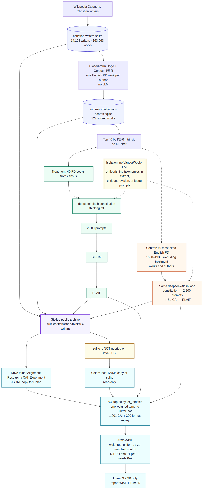

# Christian Thinkers Writers

Public archival corpus for the **Christian Thinkers Writers** project: a versioned, citable backup of the Wikipedia Christian-writers census, I/E-R intrinsic-motivation scores, and Constitutional AI (CAI) **treatment vs citation-control** datasets.

This repository is an **archive**, not a hosted app or database. It exists so Phoenix (and later arXiv reviewers) can open the artifacts on GitHub.

**Start here — coverage pages (in-repo):**

- [Experiment pipeline flowchart](docs/pipeline-flowchart.md)
- [Treatment CAI coverage (Steps 0–4, `deepseek-flash`)](docs/cai-deepseek-coverage.md)
- [Control CAI coverage (citation-control, Steps 0–4, `deepseek-flash`)](docs/cai-control-coverage.md)
- [3-arm Colab notebook (current run is v3, Llama 3.2 3B)](docs/cai-3way-colab.md)
- [CAI protocol — I/E-R intrinsic top 40](docs/cai-protocol-intrinsic-subset.md)
- [Christian writers census coverage](docs/christian-writers-coverage-report.md)
- [Intrinsic-motivation scoring coverage](docs/intrinsic-motivation-coverage.md)
- [Scoring method (Hoge + Gorsuch I/E-R)](docs/intrinsic-motivation-scoring.md)

Related notes: [project context](docs/project-context.md), [legacy Gemini coverage](docs/cai-gemini-coverage.md) (discarded; regenerated with DeepSeek), [scoring plan](docs/intrinsic-motivation-scoring-plan.md).

## Experiment flowchart

Census → closed-form I/E-R scoring → treatment vs control CAI → GitHub archive → Drive JSONL copy → v3 Colab (top 20 books, three arms, WiSE-FT λ=0.5). Mermaid source: [`docs/pipeline-flowchart.md`](docs/pipeline-flowchart.md).



## Research question

Does aligning language models with a **Christian, intrinsically motivated virtue ethic** — texts ranked by Gorsuch & McPherson **I/E-R intrinsic** (not an I−E filter) — reduce alignment failures relative to a **citation-matched public-domain control** that is *not* restricted to Christian writers?

Constitution extraction, critique, revision, and judge prompts use **author-text vocabulary only** (no VanderWeele domains, FAI, or other external flourishing taxonomies).

## Treatment vs control

| | Treatment | Control |
|---|---|---|
| Tree | [`cai-pipeline/`](cai-pipeline/) | [`cai-pipeline-control/`](cai-pipeline-control/) |
| Coverage | [`docs/cai-deepseek-coverage.md`](docs/cai-deepseek-coverage.md) | [`docs/cai-control-coverage.md`](docs/cai-control-coverage.md) |
| Book set | I/E-R intrinsic **top 40** English public-domain works from the Christian-writers census (one scored PD work per author) | **40 most-cited** English PD texts in the **same publication-year window (1500–1930)**, excluding those 40 treatment works **and their authors** |
| Model | `deepseek-flash` (thinking off) | same |
| Prompt set | 2,000 elicited + 500 UltraChat = **2,500** | same size, same protocol |
| SL-CAI / RLAIF | 2,500 / 2,500 rows | 2,500 / 2,500 rows |

Treatment examples: Brother Lawrence, *The Practice of the Presence of God*; Ignatius of Loyola, *Spiritual Exercises*; Julian of Norwich, *Revelations of Divine Love*.

Control examples: William James, *The Principles of Psychology*; Darwin, *The Expression of the Emotions*; Shakespeare, *Hamlet* (citation-ranked PD, not a Christian-writers filter).

The 2,500-row files above are the Steps 0–4 archive. The current training run is **v3**, in [`colab/cai_3way_experiment_and_eval_v3.ipynb`](colab/cai_3way_experiment_and_eval_v3.ipynb). Coverage: [`docs/cai-3way-colab.md`](docs/cai-3way-colab.md). The v1 notebook ([`colab/cai_3way_experiment_and_eval.ipynb`](colab/cai_3way_experiment_and_eval.ipynb)), the v1_fixed notebook, and the v2 notebook ([`colab/cai_3way_experiment_and_eval_v2.ipynb`](colab/cai_3way_experiment_and_eval_v2.ipynb)) stay in the repo and are not the run to open.

## Current training run (v3)

v1 trains two arms on the book dialogues with one seed. v2 keeps all 40 books, adds contemporary dilemmas and UltraChat, clips weights to 0.25–2, and draws rows with replacement.

v3 keeps the **20 books with the highest `ier_intrinsic` scores** (ranks 1–20 of the I/E-R list; no I−E filter). It rewrites the existing v2 `draft_0` / `revision_3` traces into one user message and one weighed assistant reply. UltraChat is not in the mix. The shared **300-row format replay** stays, at weight 1.

Three arms share one trainer:

| Arm | Rows | Weight |
|---|---|---|
| A, weighted | the 1,001 kept treatment dialogues | `w = s / mean(s)`, no clip, mean CAI weight 1 |
| B, uniform | the same rows and the same row ids | every weight 1 |
| C, control | 1,001 control dialogues, stratified by book | every weight 1 |

Each arm is those 1,001 CAI rows plus the 300 format-replay rows. Kish ESS of the weighted CAI slice is **789.94**. Max weight is **2.248**.

Every arm uses R-DPO with **α=0.01** and **β=0.1**. Rejected answers alternate between the unrevised draft and a dogmatic rewrite. Seeds are **0, 1, and 2**. The reported score is the mean of those seeds at **WiSE-FT λ=0.5**. Llama 3.2 3B only. Adapters and results go under `adapters/{ACTIVE_MODEL}/v3/` and `results/{ACTIVE_MODEL}/v3/`. The nine QLoRA trains run on Colab; this archive does not launch them. Mix files: [`colab/data/v3/`](colab/data/v3/).

## Model (`deepseek-flash`)

- Client: OpenAI-compatible `https://api.deepseek.com`
- Thinking disabled on every call (`thinking: {type: disabled}`)
- Gemini-generated principles, prompts, SL-CAI, and RLAIF labels were discarded and regenerated

## Public-domain texts (PD)

`cai-pipeline/books_raw/` and `cai-pipeline-control/books_raw/` are English **public-domain** full texts (Project Gutenberg, Wikisource, Internet Archive `pdusa`). US PD cutoff used for eligibility is **1930**. Gutenberg headers, where present, remain as distributed.

## Layout

```
README.md
LICENSE                 # PD texts stay PD; code MIT; original docs/artifacts CC BY 4.0
CITATION.cff
docs/                   # markdown coverage, pipeline flowchart, sqlite/csv/jsonl
cai-pipeline/           # treatment CAI (I/E-R top 40)
cai-pipeline-control/   # citation-control CAI
colab/                  # current run: cai_3way_experiment_and_eval_v3.ipynb; v1 and v2 notebooks stay
```

Large files (>50 MB) are stored with **Git LFS**:

- `docs/intrinsic-motivation-scores.sqlite` (~89 MB)
- `docs/christian-writers-database.jsonl` (~60 MB)

Clone with Git LFS installed (`git lfs install` then `git clone`).

## Databases and tables

| File | What it is |
|---|---|
| [`docs/christian-writers.sqlite`](docs/christian-writers.sqlite) | Wikipedia `Category:Christian writers` census: 14,128 writers, 163,063 works |
| [`docs/intrinsic-motivation-scores.sqlite`](docs/intrinsic-motivation-scores.sqlite) | Closed-form Hoge + I/E-R scores on one English PD work per kept author (527 scored) |
| [`cai-pipeline/data/state.db`](cai-pipeline/data/state.db) | Treatment CAI checkpoint (extract / SL-CAI / RLAIF) |
| [`cai-pipeline-control/data/state.db`](cai-pipeline-control/data/state.db) | Control CAI checkpoint |

CSV/JSONL exports live next to the census sqlite. A gzip of the scores sqlite is at [`docs/intrinsic-motivation-scores.sqlite.gz`](docs/intrinsic-motivation-scores.sqlite.gz).

## Pipeline outputs (each tree)

- `books_raw/` — 40 source texts
- `data/corpus_manifest.json`
- `data/constitution.json` — clustered critique/revision pairs
- `data/prompts_dataset.jsonl` — 2,500 prompts
- `data/sl_cai_train.jsonl` — Stage 1 SFT
- `data/rlaif_dpo_train.jsonl` — Stage 2 DPO pairs
- `scripts/` — Steps 0–4 (`deepseek-flash`); the current Colab run is [`colab/cai_3way_experiment_and_eval_v3.ipynb`](colab/cai_3way_experiment_and_eval_v3.ipynb)

## License

- **Public-domain source texts** in `books_raw/` stay in the public domain.
- **Code** (`scripts/`, `requirements.txt`) is [MIT](LICENSE).
- **Original documentation and generated research artifacts** (coverage pages, constitutions, CAI JSONL, census/score tables) are [CC BY 4.0](https://creativecommons.org/licenses/by/4.0/).

No API keys, `.env` files, or agent-only notes are included.
