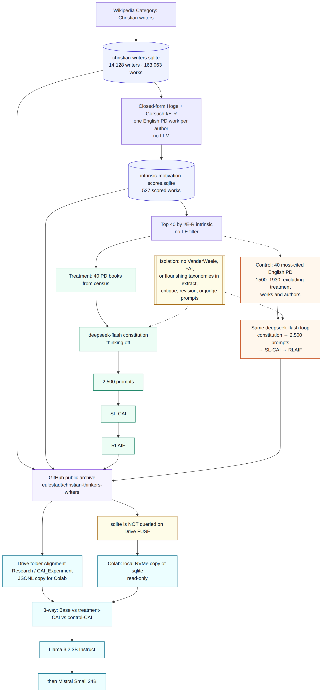
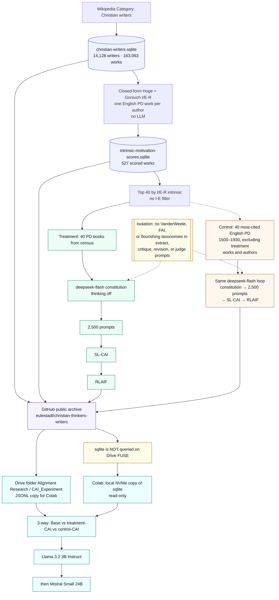

# Experiment pipeline

Whole-experiment map for the Christian Thinkers Writers CAI archive: census and closed-form scoring, treatment vs citation-control Constitutional AI, GitHub + Drive layout, and the Colab 3-way eval.

GitHub also renders the mermaid source below. Regenerable from [`pipeline-flowchart.mmd`](pipeline-flowchart.mmd).

**Isolation:** extract, critique, revision, and judge prompts use author-text vocabulary only. No VanderWeele domains, FAI, or other flourishing taxonomies.

## Stages

1. **Census.** Walk Wikipedia `Category:Christian writers` into [`christian-writers.sqlite`](christian-writers.sqlite) (14,128 writers, 163,063 works). Coverage: [census](christian-writers-coverage-report.md).
2. **Closed-form I/E-R scoring (no LLM).** Hoge + Gorsuch I/E-R on one English public-domain work per kept author → [`intrinsic-motivation-scores.sqlite`](intrinsic-motivation-scores.sqlite) (527 scored). Rank by I/E-R intrinsic only (no I−E filter) → top 40. Coverage: [scoring](intrinsic-motivation-coverage.md), [method](intrinsic-motivation-scoring.md).
3. **Treatment CAI.** Those 40 PD books → `deepseek-flash` constitution (thinking off) → 2,500 prompts → SL-CAI → RLAIF. Tree: [`cai-pipeline/`](../cai-pipeline/). Coverage: [treatment](cai-deepseek-coverage.md).
4. **Control CAI.** 40 most-cited English PD works, publication years 1500–1930, excluding the treatment works and their authors → the same `deepseek-flash` loop. Tree: [`cai-pipeline-control/`](../cai-pipeline-control/). Coverage: [control](cai-control-coverage.md).
5. **GitHub public archive.** This repo is the citable source of truth (including Git LFS sqlite).
6. **Drive.** Shared folder **Alignment Research** / `CAI_Experiment` holds a JSONL copy for Colab. **Do not** open sqlite on Drive FUSE (`database is locked` / metadata touches).
7. **Colab 3-way.** Base vs treatment-CAI vs control-CAI. Train Llama 3.2 3B Instruct first, then Mistral. Copy sqlite onto local NVMe, `chmod 0444`, open `file:...?mode=ro&immutable=1`. Notebook: [`colab/cai_3way_experiment_and_eval.ipynb`](../colab/cai_3way_experiment_and_eval.ipynb). Coverage: [Colab](cai-3way-colab.md).
